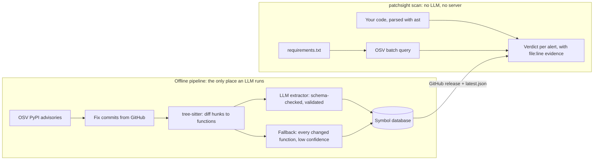

# PatchSight

[](https://github.com/professor3333/PatchSight/actions/workflows/ci.yml)

Symbol-level vulnerability triage for Python dependencies.



Dependency scanners flag a package version as vulnerable even when your code never touches the vulnerable function, so alerts can't be ranked. Fixing that needs to know *which functions* carry each bug. For PyPI that data barely exists: of **7,105** PyPI vulnerabilities in OSV on 2026-11-14, **2** say which functions are affected ([Week 1 report](docs/reports/week1-data-gate.md)).

PatchSight builds that data. Offline, an LLM reads each advisory's fix commit and picks out the vulnerable functions, fenced in by deterministic checks. Your scan then needs no model and no server: one OSV query, a database lookup, and static analysis of your code. Your code never leaves your machine; OSV receives only package names and versions.

## Status

Early development. This works today:

- the offline pipeline from OSV ingestion to fix-commit mapping, the LLM extractor, and a database builder;
- `patchsight scan` for `requirements.txt`, and `patchsight db` for downloading the database;
- the benchmark harness, which reproduces the published baseline (see [Results](#results-so-far)).

Not done yet:

- **No database release is published yet.** `patchsight db update` will say so. The first release (fallback records for every PyPI vulnerability with a GitHub fix) comes next. LLM-extracted records follow.
- No PyPI package yet, so install from GitHub.
- No `uv.lock` or `poetry.lock` support, no GitHub Action, no VEX output.

## Install and use

```bash
pip install "patchsight @ git+https://github.com/professor3333/PatchSight"

patchsight db update            # download the latest database release (none published yet)
patchsight db info              # show which database a scan uses, and how old it is
patchsight scan .               # scan ./requirements.txt and the code under .
patchsight scan . --requirements requirements/prod.txt --format json
patchsight scan . --fail-on called   # exit 1 if any alert is CALLED (for CI)
```

`--db PATH`, or the `PATCHSIGHT_DB` environment variable, selects a specific database file.

Example output. This scan used a database built from a 100-vulnerability sample, so most alerts are still *unknown*:

```text
Lockfile: requirements.txt (3 pinned, 1 unpinned)   Alerts: 91 (95 advisory IDs)   DB: 2026.11.14 (fallback-v1)

CALLED (fix first)  2
  GHSA-87cj-px37-rc3x (also PYSEC-2021-116)  bikeshed 2.4.7
    your code references a vulnerable symbol
    matched: bikeshed.InputSource.FileInputSource
    at: app/main.py:6
    symbol data: low confidence
  ...
NOT IMPORTED (transitive only)  1
  GHSA-qvrw-v9rv-5rjx (also PYSEC-2023-251)  aiohttp 3.9.0rc0
    your code never imports aiohttp; transitive use is not analysed
UNKNOWN (no symbol data, low confidence, or dynamic use)  88
  ...
```

## What the verdicts mean

| Verdict | Meaning |
|---|---|
| **CALLED** | A reference in your code resolves to a vulnerable function, its class, or an entry point that reaches it. Fix these first |
| **IMPORTED, NOT CALLED** | The package is imported, but no vulnerable symbol is referenced. Only given for high-confidence symbol data |
| **NOT IMPORTED** | Your code never imports the package directly. It may still be used through other dependencies, which is not analysed |
| **UNKNOWN** | No symbol data, only low-confidence data, or dynamic code the scanner cannot follow |

The rule throughout is to **fail towards noise, never towards silence**. A wrong "not called" could hide a real vulnerability:

- **Never hidden:** every alert OSV reports is shown.
- **Static, direct use only:** "not called" means no direct use the scanner can resolve statically.
- **Dynamic code is unknown:** `getattr` with a computed name, `importlib`, `__import__`, a module passed around as a value, and star imports all make an alert *unknown*.
- **Low confidence only raises:** symbol data marked low confidence can make an alert *called*, never *not called*.

PatchSight supports triage. It doesn't judge whether your deployment is vulnerable.

## Results so far

All numbers are measured. The reports are generated by the pipeline and committed under [`docs/reports/`](docs/reports/).

**The data (2026-11-14 snapshot):**
- **Fix commits:** 67.5% of PyPI vulnerabilities link a GitHub fix candidate. In a random sample of 100, 92 were real fixes on the package's own repository, which suggests about **62%** of all PyPI vulnerabilities have a usable fix commit (95% CI 57–65%) ([sample check](docs/reports/fix-candidate-sample.md)).
- **Python code:** 80% of those fixes change Python code.

**The benchmark harness.** On the Go benchmark of [Dunlap et al., DIMVA 2024](https://www.enck.org/pubs/dunlap-dimva24.pdf), marking every function a fix changes as vulnerable ("ChangedFuncs") reproduces the published baseline ([report](docs/reports/changedfuncs-baseline.md)):

| ChangedFuncs | Candidates | True positives | Precision | Recall | F1 |
|---|---|---|---|---|---|
| Paper, as published | 2,370 | 528 | 0.22 | 0.90 | 0.35 |
| PatchSight's pipeline | 2,330 | 525 | 0.225 | 0.893 | 0.360 |

`make reproduce` recomputes this table in seconds from committed files, with no network or API key, and CI runs it on every push. It uses [`benchmarks/dunlap-v1/`](benchmarks/dunlap-v1/), which holds function names, paths and commit SHAs but no third-party code.

**LLM extraction** is being evaluated on a frozen 60-report development split (`splits/dunlap-v1.json`); 220 test reports are held back. Results will be published here once the runs are reproducible from committed files.

## How it works

The offline pipeline is `python -m patchsight.pipeline <command>`:

| Command | Does |
|---|---|
| `snapshot`, `normalise` | Download the OSV PyPI dump with its SHA-256 pinned; normalise records, excluding malicious-package reports and withdrawn advisories |
| `week1-report`, `fix-sample` | Measure the data: fix-link coverage, existing symbol data, real-fix share |
| `build-db`, `package-db` | Build the symbol database and package it as a release, with `releases/latest.json` |
| `fetch-dunlap`, `dunlap-baseline`, `dunlap-extract`, `reproduce` | The Go benchmark: baseline, LLM extraction, offline reproduction |

The LLM extractor sends the advisory and the fix's numbered changed functions to an open-weight model (Qwen3.8-27B):
- The model answers in a strict JSON schema, with candidate IDs only.
- Code checks every answer: one verdict per candidate, no invented IDs, and every "vulnerable" verdict must cite a change shown under that function. A failed answer gets one repair attempt, then goes to a dead-letter table.
- Advisory text and code are treated as untrusted data.

Design decisions are recorded in [`docs/adr/`](docs/adr/), and the full design is in [`docs/proposal.md`](docs/proposal.md).

## Development

```bash
uv sync --all-extras   # the offline pipeline needs the 'pipeline' extra
make check             # ruff, mypy (strict) and the offline tests; no network or keys
make reproduce         # the benchmark table, from committed files
```

Tests never call a model or a live API. Network and model tests are marked `live`, and run only on demand.

## Data and licences

- **Code:** Apache License 2.0 ([LICENSE](LICENSE)).
- **Advisory data:** from [OSV.dev](https://osv.dev), the [GitHub Advisory Database](https://github.com/github/advisory-database) and the [PyPA Advisory Database](https://github.com/pypa/advisory-database), all CC BY 4.0. Any database or dataset PatchSight publishes credits them and states what changed.
- **Benchmark:** Dunlap et al. (Apache-2.0) and the Go vulnerability database (CC BY 4.0).
- **Third-party source code:** never redistributed. Only commit SHAs, file paths, line ranges and function names are stored.

## Limitations

- **Static analysis:** Python is dynamic, so "not called" is a claim about statically resolvable code only, and transitive use through other packages isn't analysed.
- **Limited to the fix commit:** a vulnerable function that the fix left unchanged can't be found from the patch alone. PyYAML's CVE-2020-14343, whose fix only changes module-level registration calls, is one example.
- **Only GitHub-hosted fixes** are used so far, and only `requirements.txt` is parsed.
