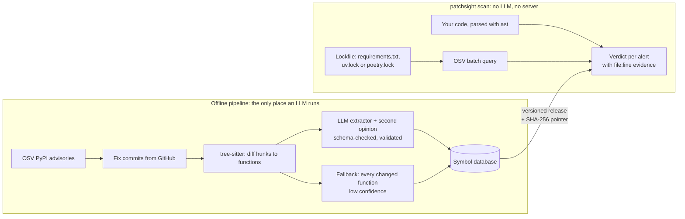

<div align="center">


# PatchSight

**Know which vulnerable dependencies your code actually calls.**

Symbol-level vulnerability triage for Python. An LLM reads each security fix offline;<br>
your scan is a database lookup and static analysis, with no model and no server.

[](https://github.com/professor3333/PatchSight/actions/workflows/ci.yml)
[](https://pypi.org/project/patchsight/)
[](pyproject.toml)
[](LICENSE)
[](docs/adr/0002-no-llm-at-scan-time.md)
[](#results-at-a-glance)
[](https://github.com/professor3333/PatchSight/releases)

[Quick start](#quick-start) · [Results](#results-at-a-glance) · [How it works](#how-it-works) · [Status](#project-status) · [Design](docs/proposal.md)

</div>

---

## Why PatchSight

Dependency scanners flag a package *version* as vulnerable, even when your code never touches the vulnerable function. Teams get dozens of alerts and no way to rank them. Ranking them needs to know **which functions carry each bug**, and for Python that data barely exists:

> [!IMPORTANT]
> Of **7,105** PyPI vulnerabilities in OSV (snapshot of 14 November 2026), only **2** record which functions are affected.
> See the [Week 1 data report](docs/reports/week1-data-gate.md).

PatchSight builds that data, then uses it:

<table>
<tr>
<td width="33%" valign="top">

**Pinpoints the vulnerable code**<br>
An open-weight LLM reads each advisory's fix commit and names the functions that carry the bug. Deterministic checks then validate every answer.

</td>
<td width="33%" valign="top">

**Keeps your code private**<br>
Scans run locally with Python's `ast`. Your code is never sent anywhere; OSV only receives package names and versions.

</td>
<td width="33%" valign="top">

**Measured, not claimed**<br>
Every number below links to a generated report, and `make reproduce` rebuilds the benchmark tables offline, with no API key.

</td>
</tr>
</table>

## Results at a glance

On the Go benchmark of [Dunlap et al. (DIMVA 2024)](https://www.enck.org/pubs/dunlap-dimva24.pdf): 280 vulnerability reports, scored on finding the vulnerable functions.

| System | Precision | Recall | F1 |
|:---|:---:|:---:|:---:|
| Mark every changed function vulnerable (*ChangedFuncs*, reproduced) | 0.225 | 0.893 | 0.360 |
| Best open model in the paper (Mixtral 8x7B) | 0.60 | 0.74 | 0.66 |
| **PatchSight: Qwen3.8-27B, 4-bit, prompt not tuned** | **0.751** | **0.621** | **0.680** |

<sub>The F1 95% interval for PatchSight is 0.62 to 0.74. 220 of the 280 reports form a held-out test split that has never been used for any decision; on it, F1 is 0.681. Reports: [baseline](docs/reports/changedfuncs-baseline.md) · [LLM run](docs/reports/extraction-dunlap-all-extract-v1-qwen3.8-27b-q4km.md) · [run provenance](docs/reports/kaggle-run-extract-v1-qwen3.8-27b-q4km.json)</sub>

**Precision is three times the naive baseline's.** Recall is lower, so the model alone sometimes misses the vulnerable function. That is why PatchSight never trusts it alone to say "not called" (see [the safety rule](#reading-the-verdicts)).

## Quick start

```bash
pip install patchsight

patchsight db update                  # download the latest symbol database (SHA-256 verified)
patchsight scan .                     # scan the lockfile and the code under .
```

<details>
<summary><b>More options</b></summary>

```bash
patchsight scan . --lockfile requirements/prod.txt        # a specific lockfile
patchsight scan . --format json                           # machine-readable output
patchsight scan . --fail-on called                        # exit 1 if any alert is CALLED (CI gate)
patchsight explain GHSA-87cj-px37-rc3x                    # why these symbols, with evidence
patchsight db info                                        # which database a scan uses, and its age
```

`--db PATH`, or the `PATCHSIGHT_DB` environment variable, selects a specific database file.

</details>

Example output, using the published database [`db-2026.11.14`](https://github.com/professor3333/PatchSight/releases/tag/db-2026.11.14):

```text
Lockfile: requirements.txt (3 pinned, 1 unpinned)   Alerts: 55 (95 advisory IDs)   DB: 2026.11.14 (fallback-v1)

CALLED (fix first)  2
  GHSA-87cj-px37-rc3x (also PYSEC-2021-116)  bikeshed 2.4.7
    your code references a vulnerable symbol
    matched: bikeshed.InputSource.FileInputSource
    at: app/main.py:6
    symbol data: low confidence
  ...
NOT IMPORTED (transitive only)  45
  GHSA-2fqr-mr3j-6wp8 (also PYSEC-2026-2112)  aiohttp 3.9.0rc0
    your code never imports aiohttp; transitive use is not analysed
  ...
UNKNOWN (no symbol data, low confidence, or dynamic use)  8
```

## Reading the verdicts

| | Verdict | Meaning |
|:---:|:---|:---|
| 🔴 | **CALLED** | A reference in your code resolves to a vulnerable function, its class, or an entry point that reaches it. **Fix these first.** |
| 🟢 | **IMPORTED, NOT CALLED** | The package is imported, but no vulnerable symbol is referenced. Given only for high-confidence data. |
| ⚪ | **NOT IMPORTED** | Your code never imports the package directly. It may still be used through other dependencies. |
| 🟡 | **UNKNOWN** | No symbol data, only low-confidence data, or dynamic code the scanner can't follow. |

> [!NOTE]
> **The safety rule: fail towards noise, never towards silence.** A wrong "not called" could hide a real vulnerability, so:
> - every alert is shown;
> - "not called" covers only direct use that can be resolved statically;
> - dynamic code (`getattr` with a computed name, `importlib`, star imports, modules passed as values) gives **unknown**;
> - low-confidence data can raise an alert to **called**, but never lower it.
>
> PatchSight supports triage. It doesn't judge whether your deployment is vulnerable.

## How it works



1. **Find the fix.** Each PyPI advisory's fix commit is resolved on GitHub and kept only if it sits on the package's own repository. In a random sample, 92 of 100 candidate links were real fixes ([sample check](docs/reports/fix-candidate-sample.md)).
2. **Map the change.** tree-sitter maps every diff hunk to the function it changes, on both sides of the fix.
3. **Ask the model, then check it.** The model sees the advisory and the numbered candidate functions, and answers in a strict JSON schema with candidate IDs only. Code then rejects invented IDs, requires one verdict per candidate, and requires every "vulnerable" verdict to cite a change shown under that function.
4. **Decide confidence.** A second model from another family must agree, and the agreed answer must include a public symbol. Anything else falls back to every changed function ([ADR 0004](docs/adr/0004-fall-back-to-the-baseline.md)).
5. **Scan locally.** Your lockfile is matched against OSV, joined with the database, and checked against your code's syntax tree.

<details>
<summary><b>Pipeline command reference</b></summary>

The offline pipeline is `python -m patchsight.pipeline <command>`.

| Command | What it does |
|:---|:---|
| `snapshot`, `normalise` | Download the OSV PyPI dump with its SHA-256 pinned, and normalise it |
| `week1-report`, `fix-sample` | Measure the data: fix-link coverage, existing symbol data, real-fix share |
| `build-db`, `package-db` | Build the symbol database, and package a release with its pointer |
| `fetch-dunlap`, `dunlap-baseline`, `dunlap-extract` | The Go benchmark: the baseline and LLM extraction |
| `export-replay`, `confidence-report`, `reproduce` | Replay committed model answers offline, compare confidence rules, rebuild the tables |
| `parity-report` | Compare two runs of the same prompt, such as the self-hosted 4-bit model against the hosted one |

</details>

## Project status

- [x] OSV ingestion with pinned snapshots, and alias grouping across GHSA, PYSEC and CVE
- [x] Fix-commit resolution, and tree-sitter hunk-to-function mapping for Python and Go
- [x] LLM extractor: versioned prompt, strict schema, validators, one repair attempt, dead-letter table, response cache
- [x] Benchmark harness that reproduces the published baseline, and `make reproduce` in CI
- [x] `patchsight scan` for `requirements.txt`, `uv.lock` and `poetry.lock`, with `patchsight explain`, `db update` and `db info`
- [x] Confidence tiers from two model families, chosen on the dev split ([ADR 0004](docs/adr/0004-fall-back-to-the-baseline.md))
- [x] **Public symbol database:** [releases](https://github.com/professor3333/PatchSight/releases), updated **every night** by the [nightly pipeline](.github/workflows/nightly.yml) after a release gate ([ADR 0006](docs/adr/0006-nightly-pipeline.md)). About 3,500 PyPI vulnerabilities, all low confidence so far
- [ ] LLM-extracted records for PyPI: the pipeline, confidence tiers and per-symbol evidence are built; the self-hosted backfill is running on Kaggle (1 of 4 shards merged)
- [ ] Held-out test evaluation of the confidence rule (declared in advance; in progress)
- [x] **On PyPI:** [`pip install patchsight`](https://pypi.org/project/patchsight/) (0.1.0), published from CI with Trusted Publishing and a required approval
- [ ] A GitHub Action, SARIF and OpenVEX output

> [!WARNING]
> **The confidence rule doesn't meet its safety target yet.** On the dev split, high-confidence records still miss the vulnerable symbol in 1 of 27 reports: 3.7%, against a target of 2% or less ([report](docs/reports/confidence-dunlap-dev-extract-v1-qwen3.8-27b-q4km-vs-extract-v1-gpt-oss-120b.md)). Until it does, treat **imported, not called** as a prioritisation hint, not a guarantee.

## How database releases work

- **Every night**, [`nightly.yml`](.github/workflows/nightly.yml) snapshots OSV, rebuilds only the advisories whose extraction inputs changed, and runs a [release gate](src/patchsight/pipeline/gate.py) against the previous release.
- **A passing build** becomes a dated, immutable release (`db-YYYY.MM.DD`), and the pointer `latest.json` on the [`db-pointer`](https://github.com/professor3333/PatchSight/tree/db-pointer) branch moves to it. `patchsight db update` follows that pointer and verifies the download's SHA-256.
- **A failing build** publishes nothing and opens an issue.
- **Rollback** is one commit: revert the pointer move on `db-pointer`. Releases are never deleted.

## Development

```bash
uv sync --all-extras    # the offline pipeline needs the 'pipeline' extra
make check              # ruff, mypy (strict) and the offline tests: no network, no keys
make reproduce          # rebuild the benchmark tables from committed files
```

Tests never call a model or a live API. Design decisions are recorded in [`docs/adr/`](docs/adr/), and the full design is in [`docs/proposal.md`](docs/proposal.md).

<details>
<summary><b>Project layout</b></summary>

```text
src/patchsight/
├── cli.py              patchsight scan / db (no LLM, no pipeline imports)
├── db.py               the symbol database (stdlib sqlite3)
├── scan/               lockfiles, OSV client, AST scanner, verdicts, reports
├── pipeline/           offline only: ingest, diffs, LLM client, extraction, benchmarks
└── eval/               metrics, confidence tiers, the safety view
benchmarks/dunlap-v1/   candidate metadata and model answers for offline replay (no code)
docs/                   proposal, ADRs, generated reports
```

</details>

## Contributing and security

- **Wrong symbols for an advisory?** Open a [wrong symbol data](https://github.com/professor3333/PatchSight/issues/new?template=wrong_symbols.yml) report with the output of `patchsight explain`.
- **Found a bug?** Use the [bug report](https://github.com/professor3333/PatchSight/issues/new?template=bug_report.yml) form. To contribute code, see [CONTRIBUTING.md](CONTRIBUTING.md).
- **Security problem?** Report it privately, as described in [SECURITY.md](SECURITY.md).

## Data and licences

| | |
|:---|:---|
| **Code** | Apache License 2.0 ([LICENSE](LICENSE)) |
| **Advisory data** | [OSV.dev](https://osv.dev), the [GitHub Advisory Database](https://github.com/github/advisory-database) and the [PyPA Advisory Database](https://github.com/pypa/advisory-database), all CC BY 4.0. Published databases credit them and state what changed |
| **Benchmark** | Dunlap et al. (Apache-2.0) and the Go vulnerability database (CC BY 4.0) |
| **Third-party code** | Never redistributed. Only commit SHAs, file paths and function names are stored |

## Limitations

- **"Not called" is a static claim.** Python is dynamic, and use through other packages isn't analysed.
- **Patch-based extraction has a ceiling.** A vulnerable function the fix left unchanged can't be found from the patch alone. PyYAML's CVE-2020-14343, whose fix only edits module-level registration calls, is one example.
- **GitHub-hosted fixes only.** Advisories whose fix lives elsewhere get no symbol data, so their alerts stay UNKNOWN.
