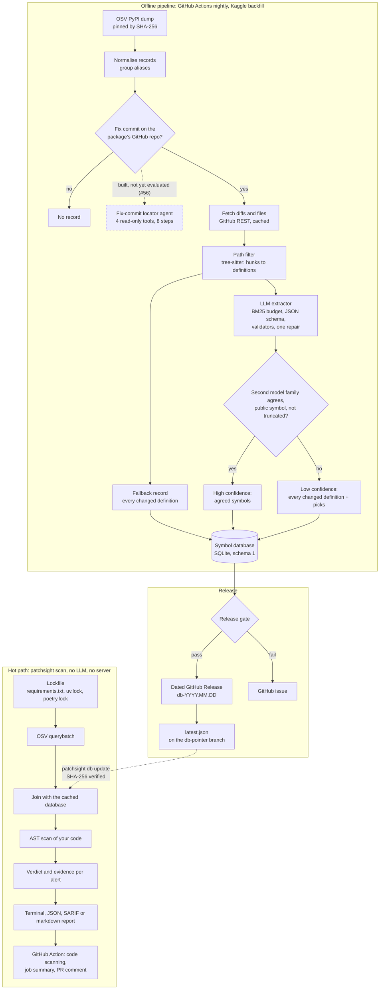

# Architecture

PatchSight has two halves that meet at one artefact:

- an **offline pipeline**, the only place a language model runs;
- a **hot path**, `patchsight scan`, with no model and no server.

The versioned **symbol database** is the only thing that crosses between them. This page describes the system as built. Parts that are designed but not built yet are marked *planned* and link to their issues. The target design is in the [proposal](proposal.md#8-system-architecture).

## Offline pipeline

Each stage is plain Python under `src/patchsight/pipeline/`, run through `python -m patchsight.pipeline <command>`. There is no orchestration framework.

| Stage | What it does | Code |
|---|---|---|
| Snapshot | Downloads OSV's PyPI dump and records its SHA-256 in `manifests/snapshot.json`. | `ingest/snapshot.py` |
| Normalise | Keeps PyPI advisories, drops malicious-package reports and withdrawn records, and groups GHSA, PYSEC and CVE aliases into one vulnerability. | `ingest/osv.py`, `ingest/aliases.py` |
| Classify references | A commit or pull-request URL on the package's own GitHub repository is a candidate fix. The repository comes from PyPI's project URLs. | `ingest/references.py`, `pypi.py` |
| Fetch | Commits, pull-request commits and file contents at the fix and its parent, through a cached HTTP client that waits out rate limits. An offline mode serves only from the cache. | `diffs/github.py`, `diffs/commits.py`, `http.py` |
| Map | Drops tests, docs, changelogs and vendored code by path, then maps every hunk, on both sides, to its innermost function, method or class with tree-sitter. | `diffs/paths.py`, `diffs/hunks.py`, `diffs/mapping.py` |
| Fallback record | Every changed definition, at low confidence. A fix that changes only module-level code (registration calls, a pattern list) lists the definitions those lines name or use instead. Fixes that change more than 500 definitions get no record (`too_broad`). | `build_db.py`, `diffs/mapping.py` |
| Render | Numbers the candidates (`F1`…) and hunks (`H1`…), delimits untrusted text, and ranks candidates with BM25 against the advisory text when they exceed the 4,600-token budget. Truncation is recorded. | `extract/prompt.py`, `prompts/extract_v1.md` |
| Extract | One call per vulnerability through one OpenAI-compatible client, with a strict JSON schema (grammar-constrained on llama.cpp), temperature 0, a fixed seed and a response cache keyed by model, parameters, prompt version and prompt. | `llm/client.py`, `llm/config.py`, `extract/schema.py` |
| Validate | Candidate and hunk IDs must exist, every cited hunk must lie inside its symbol, and every entry point must resolve to a known definition. On failure, one repair attempt with the errors appended, then the dead-letter table. | `extract/validate.py`, `extract/extractor.py` |
| Tier | High confidence needs both families valid, an untruncated prompt, `subset` agreement and a public symbol. Anything else keeps every changed definition. Releases withhold the high tier for now ([ADR 0008](adr/0008-withhold-high-confidence.md)). | `eval/confidence.py`, `llm_records.py` |
| Write | One SQLite file, plus a `builds` ledger of input hashes so later runs rebuild only what changed. | `db.py`, `build_db.py`, `update_db.py` |

The LLM stages run in two places today:

- **The Kaggle backfill.** Qwen3.8-27B (4-bit) on llama.cpp, two T4 GPUs, one shard of the PyPI vulnerabilities per session. It works offline from a private input bundle (`export-kaggle-inputs`), because the bundle holds third-party code. Its answers come home as a zip and are replayed locally with no model calls (`import-kaggle-run`, `pypi-extract --cache-only`). `merge-llm` then folds them into the published database under a new version.
- **The benchmark.** `dunlap-extract` runs the same extractor on the Dunlap Go benchmark. Replay bundles in `benchmarks/dunlap-v1/` hold the answers and candidate metadata, with no source code, so `reproduce` rebuilds the results table in CI with no network and no key.

The nightly workflow builds fallback records for new and changed advisories and carries every unchanged record forward, including the backfill's model picks. With the `GROQ_API_KEY` secret it also extracts, with Qwen3.8-27B on Groq, the night's changed vulnerabilities and then those still waiting for picks, at most 25 a night, and merges the picks into that night's release before the gate ([ADR 0013](adr/0013-llm-extraction-in-the-nightly.md)).

## The symbol database

One SQLite file, schema version 1. Tables added since the first release are additive, so older CLIs still read newer files.

| Table | One row per | Holds |
|---|---|---|
| `records` | vulnerability and package | confidence, source (`llm`, `fallback`, `override`), import roots (from the package's wheels when they can be read), entry points, fix commits, model, prompt version, input hash, advisory `modified`, truncation flag, extraction time |
| `symbols` | symbol of a record | qualified name, module, name, kind (function, method, class), file path |
| `evidence` | model-picked symbol | the one-sentence rationale and the cited hunks: commit, path and line ranges |
| `extraction` | LLM record | the second-opinion model and why the tier was chosen |
| `aliases` | identifier | the vulnerability it belongs to, for every vulnerability the builder considered, with or without a record, so a scan shows one alert per vulnerability |
| `builds` | vulnerability | its input hash and build status (`built`, `module_level_references`, `no_python_fix`, `module_level_only`, `no_github_fix`, …). A scan uses the status to say why an alert has no symbol data |
| `import_names` | package | the top-level import names in its wheels on PyPI, and which wheels were read ([ADR 0009](adr/0009-import-names-from-wheels.md)) |
| `meta` | key | database version, schema version, builder, code commit, snapshot SHA-256 |

No third-party source code is stored: only names, paths, line ranges and commit SHAs (rule 13 of the design).

## Hot path

`patchsight scan` does five things, in order:

1. **Parse the lockfile.** `requirements.txt` (with `-r` includes, markers and hashes), `uv.lock` and `poetry.lock`. Only exact pins give a version; anything else is reported as unpinned (`scan/lockfiles/`).
2. **Ask OSV.** One `querybatch` request to `api.osv.dev` with package names and versions only (`scan/osv_client.py`).
3. **Join with the database.** Through the alias table, so all IDs of one vulnerability become one alert.
4. **Scan your code.** The standard library `ast` module finds imports and references: aliases, from-imports, attribute chains, names passed as arguments, and dynamic use such as `getattr` with a computed name or `importlib` (`scan/ast_scanner.py`). It also records what could reach vulnerable code unseen, each of which withholds "not called": unused from-imports (possible re-exports), attributes of objects it cannot type, and names inside template tags, in Python strings and template files. It also reads the files that start processes (Dockerfiles, Procfiles, scripts, CI workflows): a package named there is never "not imported" or "not called" ([ADR 0012](adr/0012-packages-run-as-commands.md)).
5. **Decide and report.** One verdict per alert with file-and-line evidence (`scan/verdicts.py`), as text, JSON, SARIF 2.1.0 for code scanning (`scan/report.py`, `scan/sarif.py`), or markdown for a pull-request comment or job summary. Every alert is shown; in SARIF, CALLED is an error, UNKNOWN a warning and the rest notes. The markdown report counts every verdict and, if GitHub's comment limit forces it to leave rows out, says how many. The [Action](../action.yml) uploads the SARIF report, writes the markdown one as the job summary and, with `comment: "true"`, keeps one pull-request comment up to date (`scripts/pr-comment.sh`). A low-confidence record can raise an alert to CALLED but never lower it.

The scan makes two kinds of network call: the OSV query, and the database download when the cache is empty or `patchsight db update` is run. The download follows `latest.json` on the `db-pointer` branch (falling back to `main` only if that file is missing), verifies the SHA-256 and schema version, and swaps the file in atomically (`scan/dbcache.py`). The scan warns when the database is more than 7 days old. There is no telemetry.

`tests/test_import_boundary.py` checks that no hot-path module imports the pipeline, `openai` or `tree-sitter`, and the published package doesn't depend on them.

## Releases and operations

| Workflow | Trigger | What it does |
|---|---|---|
| [`ci.yml`](../.github/workflows/ci.yml) | every push and pull request | ruff, mypy, offline pytest, `reproduce` of the benchmark table, and `regression-check` of the PyPI regression set. No secrets |
| [`nightly.yml`](../.github/workflows/nightly.yml) | 03:17 UTC daily, or by hand | snapshot, `update-db`, extraction of the night's changed vulnerabilities when the Groq secret is set ([ADR 0013](adr/0013-llm-extraction-in-the-nightly.md)), release gate, dated release, pointer move by `github-actions[bot]`; an issue on failure |
| [`release.yml`](../.github/workflows/release.yml) | a `v*` tag | full tests, `reproduce`, build, clean-install smoke test, then PyPI through Trusted Publishing after the owner approves, and the GitHub Release |

- **Release gate** (`gate-db`): the builds ledger covers every vulnerability with a record; every record has between 1 and 500 symbols; every record is found by its own ID and every alias points at a record; no more than 2% of vulnerabilities (at least 10 allowed) lose their records at once; a high-confidence record whose inputs did not change stays high; and no record is high confidence while ADR 0008 withholds the tier.
- **Releases are immutable.** Rollback is one commit that moves `latest.json` on `db-pointer` back ([ADR 0006](adr/0006-nightly-pipeline.md)). It was rehearsed and timed: users followed within 5 minutes ([report](reports/rollback-rehearsal-2026-11-18.md)).
- **A release that merges new extractions** (a backfill shard, a top-up run) is prepared by `scripts/prepare-merged-release.sh <version> <outcomes>...`: it downloads the current release as users get it, merges, restores the import names, runs the release gate and writes the asset, the pointer and the notes. It stops at the first failure and publishes nothing; the GitHub release and the pointer commit on `db-pointer` follow by hand.
- **Shadow, then promote.** A prompt, model or validator change reaches users only through this path:
  1. The change lands on a branch with its before-and-after evaluation (`docs/experiments.md`) and, when its output moves, a re-pinned [regression set](../benchmarks/pypi-regression-v1/README.md).
  2. The affected prompts are re-extracted. Unchanged prompts replay from the cache at no cost.
  3. `merge-llm` folds the new answers into a copy of the production database, as a **shadow** version that is never released or pointed to.
  4. `db-diff <production> <shadow>` writes `docs/reports/shadow-<name>.md`: what changed, by field, and a seeded sample of 20 changed records. A person reads each one with `explain` and the fix commit, and marks it better, same or worse, with a reason.
  5. After a week of nightly releases, the shadow is rebuilt on the latest production and compared again. If no "worse" verdict is left unexplained, it is promoted: the change merges, and the database goes out through the gate like any release.
- **Tracing** (`pipeline/trace.py`): every extraction run writes `data/interim/traces/<run>-<start>.jsonl`. It holds the run's start and end, one line per model call (model, prompt version, input hash, cache hit, outcome, tokens, seconds) and one per extraction. No prompt, answer or account detail is written, and a trace that cannot be written never stops the run. Kaggle runs bring their traces home in the zip.
- **Operations dashboard** (`operations-report`, [report](reports/operations.md)): Kaggle sessions and GPU hours by week, traced runs, each hosted model's tokens against its daily cap, and what the published database holds: records by source and confidence, tier reasons and second-opinion coverage.
- **Suites:** the injection suite and the deterministic robustness suite run as described in the [threat model](threat-model.md). The [regression set](../benchmarks/pypi-regression-v1/README.md) pins the Python path's output for 50 PyPI vulnerabilities: their recorded answers go through the live extraction loop, evidence, naming, entry-point qualification and record merge on every push.
- **Planned:** a Langfuse export of the traces ([#60](https://github.com/professor3333/PatchSight/issues/60)), the Hugging Face dataset and OpenVEX output.

## Design rules and where they are enforced

| Rule | Enforced by |
|---|---|
| No LLM at scan time ([ADR 0002](adr/0002-no-llm-at-scan-time.md)) | `tests/test_import_boundary.py`; optional `pipeline` extra |
| The model answers with IDs, not names | the JSON schema and `extract/validate.py` |
| Every vulnerable symbol cites a hunk inside it | `extract/validate.py` |
| Fail towards noise ([ADR 0004](adr/0004-fall-back-to-the-baseline.md), [ADR 0008](adr/0008-withhold-high-confidence.md)) | `llm_records.py`, `scan/verdicts.py`, a property test that a low-confidence record is never worse than the fallback, the gate's `high_withheld` check, and the [reachability fixtures](../tests/fixtures/reachability/) (0 false suppressions, checked in CI) |
| Re-extract only when inputs change ([ADR 0001](adr/0001-re-extract-only-when-inputs-change.md)) | input hashes, the response cache and the `builds` ledger |
| No vector database ([ADR 0003](adr/0003-no-vector-database.md)) | BM25 only, in `extract/prompt.py` |
| Two model families for high confidence ([ADR 0005](adr/0005-two-model-families.md)) | `eval/confidence.py` |
| Determinism | temperature 0, fixed seeds, deterministic BM25 ties, cached responses |

Measured results, including the ones that lost, are in [`experiments.md`](experiments.md) and [`reports/`](reports/). The model and the data are described in the [model card](model_card.md) and the [dataset card](dataset_card.md).
