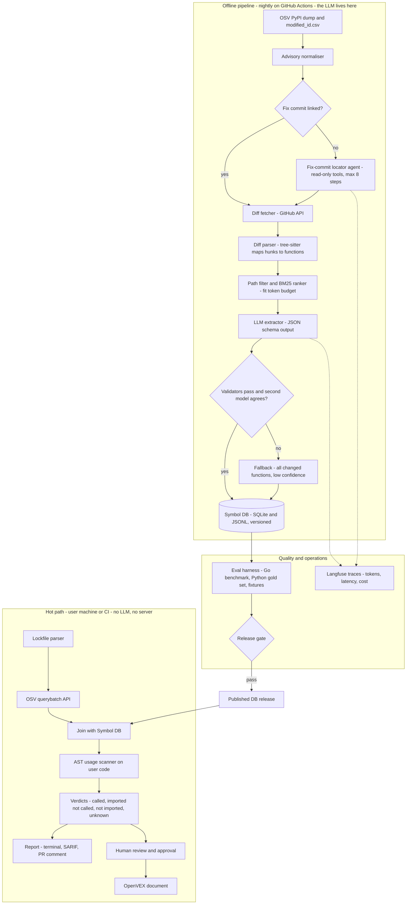

# PatchSight — Flagship LLM Engineering Project Proposal

Nov 14, 2026 · @Niroj

## Summary

Build **PatchSight**: a system that uses an LLM to read security patches and work out which functions in a vulnerable Python package are actually vulnerable, then checks whether your code calls them.

Four reasons it beats the alternatives I weighed (a terms-of-service change tracker, a citation verifier, a GitHub issue triager):

-   **The gap is real and current.** Google's OSV-Scanner runs call analysis for Go by default and for Rust and Java JARs experimentally; Python is not on that list ([call-analysis guide](https://oneuptime.com/blog/post/2026-07-23-osv-scanner-call-analysis/view)). Go has it because its security team hand-curates vulnerable symbols per advisory ([Go vulnerability database](https://go.dev/security/vuln/database)). PyPI has the field but little data in it.

-   **An LLM is justified by published evidence, not taste.** Treating every function changed in a fix as vulnerable scores precision 0.22; open LLMs in 2024 reached 0.60 at recall 0.74 on the same data ([Dunlap et al., DIMVA 2024](https://www.enck.org/pubs/dunlap-dimva24.pdf)).

-   **Free ground truth exists.** The Go database's curated symbols give you a labelled benchmark with a published baseline to beat, so evaluation is objective from day one.

-   **It runs at zero cost.** The LLM works offline on public advisories. A user's scan is a database lookup plus static analysis: no LLM call, no server, no per-request cost.

It deliberately has no chatbot and no vector database. The interview story is the opposite of "I wired an API to a frontend": you put the LLM where it earns its keep, fenced it with deterministic checks, and measured it against a published baseline.

Every number labelled a *target* below is an acceptance threshold to hit, not a result. Nothing here has been built or measured yet.

## 1. Project name

**PatchSight: symbol-level vulnerability triage for Python dependencies.**

PatchSight builds an open database that maps each PyPI security advisory to the specific functions and classes that carry the bug, extracted by an LLM from the fix commit. A command-line tool and GitHub Action then use that database to label every dependency alert in a repository as *called*, *imported but not called*, *not imported*, or *unknown*, with file-and-line evidence.

Check PyPI and GitHub for name collisions before you publish. The name is a suggestion; the design does not depend on it.

## 2. Real-world problem

Dependency scanners flag a package version as vulnerable even when the application never touches the vulnerable code, so teams drown in alerts they cannot rank.

**Why it matters**

-   Endor Labs reports that fewer than 9.5% of dependency vulnerabilities are exploitable at the function level ([Dependency Management Report](https://www.endorlabs.com/lp/dependency-management-report)).

-   Knowing reachability changes behaviour: in Semgrep's 2025 data across 50,000+ repositories, top teams fixed 92% of reachable dependency findings against 67% of non-reachable ones ([summary](https://thehackernews.com/expert-insights/2026/03/which-code-vulnerabilities-actually-get.html)).

-   Reachability for Python is sold by commercial vendors. The free path is thin: GitHub launched vulnerable-call detection for Python as a beta in 2022 with function data for 79 advisories ([changelog](https://github.blog/changelog/2022-04-14-dependabot-alerts-show-vulnerable-function-calls-python-beta/)), and the PyPA database defines an imports field for vulnerable attributes that entries *can* include ([pypa/advisory-database](https://github.com/pypa/advisory-database)). Measuring how many PyPI advisories actually carry symbol data is your first week-one experiment and the project's opening statistic.

**Why an LLM, and not traditional software or classical ML**

The missing input is a mapping from advisory to vulnerable functions. Building it means reading prose ("arbitrary code execution through full\_load") against a code diff and deciding which changed functions carry the fix and which are refactors, tests or drive-by cleanups.

-   **Rules fail measurably.** The rule "every changed function is vulnerable" is what automation does today. In the Dunlap study, 78% of functions modified in security patches were unrelated to the vulnerability.

-   **Classical ML has too little data.** A few hundred labelled advisories across thousands of distinct codebases will not train a classifier that understands unfamiliar code.

-   **Manual curation does not scale to PyPI.** It works for Go because one funded team does it.

**Where an LLM is the wrong tool, and is not used.** Checking whether your code calls a function is static analysis. It is deterministic, fast and auditable, so PatchSight does it with Python's ast module. This split is the main design decision to defend in interviews.

## 3. Target users

The primary user is a Python developer or small team whose pull requests are blocked or cluttered by dependency alerts they have no way to rank.

| User                                       | Scenario                                                                        | Value you can measure                                                                   |
|--------------------------------------------|---------------------------------------------------------------------------------|-----------------------------------------------------------------------------------------|
| Maintainer of a Python service or library  | Dependabot or pip-audit reports 20 alerts; they need to know which to fix today | Share of alerts given a symbol-level verdict; share labelled *not called* with evidence |
| Security engineer at a small company       | Must justify to a customer or auditor why an alert is not being patched         | Time to produce an OpenVEX statement with evidence attached                             |
| Builders of other scanners and researchers | Need symbol-level data for PyPI advisories                                      | Downloads of the open dataset; advisories covered                                       |

Measure user value on a fixed panel of about 20 real open-source Python repositories pinned to old lockfiles, so the numbers are reproducible. Do not rely on user testimonials.

## 4. Data sources and datasets

Every input is public, free and needs no scraping; the two labelled sources are what make the evaluation objective.

| Source                                                                  | Used for                                                                                   | Access                                                                                                    | Licence                                                                       |
|-------------------------------------------------------------------------|--------------------------------------------------------------------------------------------|-----------------------------------------------------------------------------------------------------------|-------------------------------------------------------------------------------|
| [OSV.dev data dumps](https://google.github.io/osv.dev/data)             | All PyPI advisories, with references to fix commits                                        | https://osv-vulnerabilities.storage.googleapis.com/PyPI/all.zip; incremental updates via modified\_id.csv | Per source: GitHub Advisory Database and PyPI Advisory Database are CC-BY 4.0 |
| [OSV API](https://google.github.io/osv.dev/api)                         | Matching a user's lockfile to advisories at scan time                                      | POST https://api.osv.dev/v1/querybatch, no key                                                            | Same as above                                                                 |
| [Go vulnerability database](https://go.dev/security/vuln/database)      | **Ground truth**: hand-curated vulnerable symbols per advisory                             | Bulk zip at https://vuln.go.dev/vulndb.zip                                                                | CC-BY 4.0                                                                     |
| [Dunlap et al. dataset](https://www.enck.org/pubs/dunlap-dimva24.pdf)   | **Published benchmark**: 280 Go reports, 2,370 modified functions, 528 labelled vulnerable | GitHub, s3c2/llm-vulnerable-functions                                                                     | Check the repository's licence before redistributing                          |
| [GitHub Advisory Database](https://github.com/github/advisory-database) | Python ground truth: some PyPI advisories carry ecosystem\_specific.affected\_functions    | Clone the repository                                                                                      | CC-BY 4.0                                                                     |
| [PyPA advisory database](https://github.com/pypa/advisory-database)     | Python ground truth: entries with ecosystem\_specific.imports                              | Clone the repository                                                                                      | CC-BY 4.0                                                                     |
| GitHub REST API                                                         | Fix commits, diffs, tag comparisons                                                        | Free personal token                                                                                       | Each repository's own licence                                                 |
| PyPI JSON API and source distributions                                  | Checking that an extracted symbol exists in the vulnerable release                         | Public                                                                                                    | Each package's own licence                                                    |

For scale: GitHub's own count lists 3,378 reviewed pip advisories across 1,044 packages ([GitHub blog](https://github.blog/security/github-advisory-database-by-the-numbers-known-security-vulnerabilities-and-what-you-can-do-about-them/)). That is small enough to process completely on free compute.

**Licensing rules to follow**

-   Advisory data is CC-BY 4.0, so your published dataset must credit OSV, GitHub, PyPA and the Go team and state what you changed.

-   Do not redistribute other projects' source code. Store commit SHAs, file paths, line ranges and symbol names; fetch the code again when needed.

**Preprocessing**

1.  Normalise each OSV record to: advisory ID and aliases, package, affected version ranges, description, references, modified timestamp.

2.  Classify references. A URL matching a commit or pull request on the package's repository is a candidate fix commit. Advisories with none go to the fix-commit locator (section 7).

3.  Fetch each diff. Drop tests, docs, changelogs, lockfiles and vendored code by path rules.

4.  Chunk by structure, not by token count. Use tree-sitter to map each diff hunk to its enclosing function or class. The unit sent to the model is one changed function with its hunks and signature.

5.  Record the naive baseline for every advisory: the set of all changed functions.

**Evaluation datasets**

-   **Go benchmark.** Reproduce the Dunlap split exactly so your numbers are comparable with a published paper.

-   **Go temporal holdout.** Go reports published after your chosen model's training cutoff. This controls for the model having memorised the database.

-   **Python gold set.** Every PyPI advisory that already carries affected\_functions or imports, plus 100 to 150 advisories you label yourself. Write a one-page labelling guideline, label each advisory twice a week apart, and report your self-agreement.

-   **Reachability fixtures.** 40 to 60 small Python programs, each pinned to a vulnerable package, half calling the vulnerable symbol (directly, via alias, via re-export) and half not.

-   **Adversarial set.** Advisories and commit messages with injected instructions, oversized diffs, fixes split across several commits, and fixes that only add a new function.

Version all five with DVC and freeze them before you tune prompts.

## 5. Finished product functionality

The finished product is three things: an open symbol database, a command-line tool that uses it, and a GitHub Action that runs the tool on pull requests.

**Core features**

-   patchsight scan &lt;path&gt; reads the lockfile (requirements.txt, uv.lock, poetry.lock), queries OSV, joins the symbol database, scans the code and prints one verdict per alert with evidence.

-   patchsight explain &lt;advisory-id&gt; shows the extracted symbols, the diff hunks each one came from, the model's one-sentence rationale, the confidence tier, and the model and prompt version that produced it.

-   patchsight vex &lt;path&gt; writes an OpenVEX document for alerts the user has reviewed and approved. The justification code is vulnerable\_code\_not\_in\_execute\_path, which OpenVEX defines for exactly this case ([Trivy VEX docs](https://trivy.dev/docs/v0.53/supply-chain/vex/)).

-   A GitHub Action that posts the scan as a pull-request comment and uploads SARIF.

-   A static website that lets anyone browse the database and read the latest evaluation report.

-   A nightly pipeline that picks up new and modified advisories and publishes a new database version only if the evaluation gate passes.

**Expected behaviour**

-   Four verdicts. **Called**: a call site resolves to a vulnerable symbol. **Imported, not called**: the package is imported but no vulnerable symbol is referenced. **Not imported**: your code never imports the package directly. **Unknown**: no symbol data, low-confidence extraction, or dynamic code the scanner cannot resolve.

-   The tool ranks alerts; it never hides one. Python is dynamic, so "not called" is a claim about the code the scanner could resolve, and the output says so.

-   No user code leaves the machine. Scanning is local; the only network calls are to OSV and to fetch the database.

-   Writing a VEX statement always needs explicit human approval, because it is a signed claim that others will rely on.

**End-to-end example** (illustrative output, not a measured result)

```text
$ patchsight scan .
Lockfile: uv.lock (143 packages) OSV matches: 11 advisories DB: 2026.11.14

CALLED (fix first) 1
GHSA-xxxx somepkg 2.1.0 parse_header() app/api/upload.py:88

IMPORTED, NOT CALLED 4
CVE-2020-14343 PyYAML 5.3.1
vulnerable: yaml.full_load, yaml.load(Loader=FullLoader)
your code: yaml.safe_load only (config/loader.py:12, 31)
confidence: high evidence: patchsight explain CVE-2020-14343
...
NOT IMPORTED (transitive only) 3
UNKNOWN (no symbol data or unresolved dynamic use) 3
```

## 6. Input, LLM workflow, output, user action

The LLM does its work days before the user arrives; the user's request never waits on a model. The example follows one advisory, PyYAML's CVE-2020-14343, through both halves. Treat the specifics as illustrative and confirm them against the advisory when you build the fixture.

**Offline, when the advisory is ingested**

1.  **Input.** The OSV record: PyYAML before 5.4 allows arbitrary code execution when untrusted YAML is processed through full\_load or FullLoader. The record links a fix commit.

2.  **Deterministic preparation.** Fetch the diff. Drop test files. Map hunks to enclosing functions with tree-sitter. Say this leaves six changed functions; that set is the naive baseline.

3.  **LLM extraction.** One call per advisory. The prompt holds the advisory text and each changed function as a numbered item with its hunks. The model returns JSON matching a schema: for each item, is\_vulnerable, a one-sentence rationale, and the evidence\_hunk\_ids it relied on; plus public\_entry\_points, the user-facing names that reach the vulnerable code.

4.  **Validation.** Code checks that every returned symbol is one of the six candidates or resolves in the package source at the vulnerable version, and that every cited hunk ID exists. Invented names are rejected.

5.  **Confidence tier.** High if validation passes and a second run with a different model agrees; otherwise low. Low-confidence records fall back to the full changed-function set, so they can raise an alert's priority but never lower it.

6.  **Output.** A database row: advisory ID, vulnerable symbols, entry points, evidence, confidence, model and prompt version, advisory modified timestamp.

**At scan time, on the user's machine**

1.  **Input.** The user runs patchsight scan . on a service pinned to PyYAML 5.3.1.

2.  **Lookup.** OSV returns CVE-2020-14343 for that version. The database returns its vulnerable symbols.

3.  **Static analysis.** The scanner parses every .py file, resolves imports and aliases (import yaml as y, from yaml import load), and looks for references to the vulnerable symbols. It finds only yaml.safe\_load.

4.  **Output.** Verdict *imported, not called*, with the two call sites it did find and a pointer to the evidence.

5.  **User action.** The developer fixes the one *called* alert today, schedules the PyYAML upgrade with normal maintenance, and, if a customer asks, approves a VEX statement for it.

## 7. LLM approach and model selection

Use open-weight models throughout: a self-hosted one on free Kaggle GPUs for the one-time backfill, and the same model family on a free hosted API for the small nightly increment.

**Which techniques, and why**

| Technique                       | Used                         | Justification                                                                                                                                                              |
|---------------------------------|------------------------------|----------------------------------------------------------------------------------------------------------------------------------------------------------------------------|
| Structured generation           | Yes, the core                | The output is a database row. It must be schema-valid and machine-checkable                                                                                                |
| Tool calling in a bounded agent | Yes, one narrow job          | Some advisories link no fix commit. Finding it needs a few adaptive lookups: compare tags, search commit messages, read a candidate diff                                   |
| Retrieval                       | Yes, small and lexical first | Some diffs exceed the token budget. Rank changed functions against the advisory text and keep the top ones. Start with BM25; add embeddings only if hunk recall is too low |
| Self-hosted serving             | Yes, for the backfill        | A few thousand advisories exceed free API quotas; a quantised model on Kaggle does not                                                                                     |
| Vector database, RAG chatbot    | No                           | Lookups are by advisory ID. Nothing here needs semantic search over a corpus                                                                                               |
| Fine-tuning (QLoRA)             | Optional, phase 3            | Only if a smaller model is needed for cost or the evaluation shows a gap prompting cannot close                                                                            |

**Models, as of November 2026**

| Role                          | Choice                                                      | Why                                                                                                                                     | Constraint to design around                                                                                                                                                                             |
|-------------------------------|-------------------------------------------------------------|-----------------------------------------------------------------------------------------------------------------------------------------|---------------------------------------------------------------------------------------------------------------------------------------------------------------------------------------------------------|
| Backfill extractor            | Qwen3.8-27B, 4-bit, served with llama.cpp or vLLM on Kaggle | Apache 2.0; about 18 GB at 4 bits, which fits Kaggle's two T4s ([open-weight roundup](https://hashnode.com/blog/best-open-weight-llms)) | Kaggle's weekly GPU quota is commonly reported as about 30 hours but is not in its docs; check your account ([free GPU survey](https://gpuperhour.com/blog/free-cloud-gpus-and-credits))                |
| Nightly extractor             | The same model on Groq's free plan                          | Same weights offline and nightly, so one set of evaluation numbers covers both                                                          | Reported limits: 30 requests a minute, 1,000 requests and 200,000 tokens a day per model ([free API tracker](https://klymentiev.com/blog/free-llm-api))                                                 |
| Second opinion for confidence | gpt-oss-120b on Groq's free plan                            | A different model family; agreement between two families is a cheap confidence signal                                                   | Same daily token cap, counted separately per model                                                                                                                                                      |
| Spare capacity                | Gemini Flash-Lite free tier                                 | Useful if Groq retires a model                                                                                                          | Free-tier limits vary by project and prompts may be used to improve Google products ([pricing guide](https://aibusinessweekly.net/p/gemini-api-pricing)). Acceptable here because every input is public |

Free rosters changed several times in 2026, so hide the provider behind one OpenAI-compatible client and treat a model swap as a routine, evaluated change.

**Context and token budget**

The binding limit is quota, not context window. Cap each extraction prompt at about 6,000 input tokens so a day's 200,000-token allowance covers roughly 30 advisories per model. Measure the real daily rate of new PyPI advisories in week one to confirm that is enough.

**Prompting strategy**

-   Start with a detailed instruction prompt and no chain-of-thought. In the Dunlap study, chain-of-thought prompts ran about 13 times slower for similar F1.

-   Run 0, 3 and 5 examples as an experiment. The same study found few-shot examples raised recall but lowered precision, so the right setting depends on your recall floor.

-   Compare one call per advisory (all candidate functions together) against one call per function. Per-advisory is cheaper and lets the model compare candidates; per-function may be more precise.

-   Number every candidate function and hunk. The model answers with IDs, not free-text names, which makes validation trivial and blocks invented symbols.

**Structured output**

Define the schema once as a Pydantic model. Use the provider's JSON-schema mode on hosted APIs and grammar-constrained decoding on the self-hosted server. On a validation failure, retry once with the error message appended, then send the advisory to a dead-letter table.

## 8. System architecture

The architecture has two halves that meet at one artefact: an offline pipeline where the LLM runs, and a hot path with no LLM and no server. The versioned symbol database is the only thing that crosses between them.



**Request and data flow**

-   *Nightly:* new or modified advisories flow top to bottom through the offline pipeline. The candidate database is scored by the evaluation harness. Only a passing build is published.

-   *Per scan:* the tool downloads the latest published database once and caches it, makes one batch call to OSV, and does everything else locally.

**Components**

| Area                       | Design                                                                                                                                                                                                                                            |
|----------------------------|---------------------------------------------------------------------------------------------------------------------------------------------------------------------------------------------------------------------------------------------------|
| Ingestion and storage      | OSV zip plus modified\_id.csv for increments. Raw records, diffs' metadata and extraction outputs kept as JSONL under DVC. The shipped artefact is one SQLite file                                                                                |
| Parsing and retrieval      | unidiff for patches, tree-sitter for Python and Go function boundaries. Path filter first, then BM25 over changed functions against the advisory text. No embedding model or vector store in the MVP                                              |
| Prompts and context        | Prompt templates are files in the repository with a version string. Every database row records prompt version, model ID and input hash                                                                                                            |
| Inference and serving      | One OpenAI-compatible client. Backends: llama.cpp or vLLM server on Kaggle for backfill, hosted free tier for nightly runs                                                                                                                        |
| Agent and state            | The fix-commit locator is a loop with four read-only tools: list references, compare two tags, search commits, get a commit. Step cap of 8. State is a plain list of messages saved per advisory, so runs can be replayed                         |
| Human approval             | Required for VEX output and for adding labels to the gold set. Not required for scans, which only read                                                                                                                                            |
| Backend, frontend, caching | No backend in the MVP. The "frontend" is the CLI, the PR comment and a static site built from the database. Cache LLM responses by input hash so re-runs are free and deterministic. Streaming is not needed: there is no interactive generation  |
| Security boundaries        | The LLM sees only public advisories and public diffs. User code never reaches a model. Agent tools can reach only api.github.com and pypi.org. API keys live in GitHub Actions secrets. No user accounts, so no authentication surface in the MVP |
| Deployment and CI/CD       | GitHub Actions for tests, nightly pipeline and releases. The CLI ships on PyPI; the database ships as a GitHub Release asset and a Hugging Face dataset; the site ships on GitHub Pages                                                           |
| Observability              | Langfuse traces for every LLM and tool call offline. The CLI logs locally and sends nothing                                                                                                                                                       |
| Versioning                 | Data and eval sets in DVC; prompts in git; database releases tagged by date with a manifest of model, prompt and eval scores                                                                                                                      |

**Essential and optional**

-   **Essential:** ingestion, diff parsing, LLM extractor with validators and fallback, symbol database, AST scanner, CLI, evaluation harness with release gate, nightly workflow, tracing.

-   **Optional:** fix-commit locator agent (build second; it raises coverage, not correctness), GitHub Action and SARIF, static explorer site, VEX export, embedding-based ranking, a hosted lookup API, fine-tuning.

One hosting note: Hugging Face's docs now say Gradio and Docker Spaces need a paid plan, with only static Spaces free ([Spaces overview](https://huggingface.co/docs/hub/en/spaces-overview)). This design needs no compute host, which is one more reason to keep the hot path serverless.

## 9. LLM engineering challenges

The governing rule is asymmetric: a wrong "not called" can hide a real vulnerability, so every uncertain case must fail towards the noisy baseline, never towards silence.

| Challenge                                   | How PatchSight handles it                                                                                                                                                                                                                                                                                                                                                                         |
|---------------------------------------------|---------------------------------------------------------------------------------------------------------------------------------------------------------------------------------------------------------------------------------------------------------------------------------------------------------------------------------------------------------------------------------------------------|
| Hallucinated symbols                        | The model answers with candidate IDs, not names. Any extra name must resolve in the package source at the vulnerable version or it is dropped. Post-validation hallucination is zero by construction; track the pre-validation rate as a model-quality metric                                                                                                                                     |
| Unsupported claims                          | Every vulnerable symbol must cite at least one hunk ID. A check confirms the hunk exists and lies inside that symbol. explain shows the evidence to the user                                                                                                                                                                                                                                      |
| Prompt injection                            | Advisory text, commit messages and code comments are attacker-writable, and an attacker's goal here is concrete: make scanners say "not affected". Defences: untrusted text is delimited and labelled as data; output is restricted to candidate IDs; an empty or sharply reduced symbol set triggers the fallback; agent tools are read-only and host-allowlisted; an injection suite runs in CI |
| Retrieval failures                          | When the ranker truncates a diff, record it. Measure hunk recall at the cut-off on the benchmark. Truncated advisories are capped at low confidence                                                                                                                                                                                                                                               |
| Context and quota limits                    | Path filtering, per-function chunking and a hard prompt budget. Oversized fixes are split across calls by file                                                                                                                                                                                                                                                                                    |
| Stale information                           | OSV modified timestamps drive re-extraction. Each row stores the advisory timestamp it was built from; the scanner warns when the local database is older than seven days                                                                                                                                                                                                                         |
| Unreliable tool execution                   | Tool calls have timeouts, retries with backoff and typed errors the agent can read. A located commit must exist, sit between the last vulnerable and first fixed tag, and touch non-test source, or the agent's answer is discarded                                                                                                                                                               |
| Malformed structured output                 | Schema-constrained decoding, Pydantic validation, one repair retry, then dead-letter                                                                                                                                                                                                                                                                                                              |
| Privacy and data leakage                    | User code is analysed locally and never sent to a model or server. Offline inputs are public. Secrets exist only in CI                                                                                                                                                                                                                                                                            |
| Latency                                     | No LLM at scan time. Offline latency matters only for throughput                                                                                                                                                                                                                                                                                                                                  |
| Token cost and rate limits                  | Response cache keyed by input hash; a token-bucket limiter per provider; nightly work sized to stay inside free quotas; backfill on self-hosted weights                                                                                                                                                                                                                                           |
| Model variability                           | Temperature 0, fixed seeds where supported, cached responses. Confidence requires agreement between two model families                                                                                                                                                                                                                                                                            |
| Changing model behaviour and retired models | Providers retire free models often. Pin model IDs, record them per row, and re-run the full evaluation before any swap. The release gate blocks a database built by a worse model                                                                                                                                                                                                                 |
| Static-analysis limits                      | Dynamic imports, getattr, reflection and calls through other dependencies cannot be fully resolved. These produce *unknown*, and the report states that "not called" covers direct, statically resolvable use only                                                                                                                                                                                |

## 10. Evaluation and benchmarking

Evaluate four things separately, each against labels that already exist or that you can generate without an LLM: symbol extraction, the fix-commit agent, hunk retrieval, and end-to-end verdicts.

**Baselines to beat**

| Baseline                      | What it is                                                                | Known score                                                 |
|-------------------------------|---------------------------------------------------------------------------|-------------------------------------------------------------|
| ChangedFuncs                  | Every changed function is vulnerable                                      | Precision 0.22, recall 0.90, F1 0.35 on the Dunlap Go split |
| Best published open LLM, 2024 | Mixtral 8x7B, 5-shot detailed prompt                                      | Precision 0.60, recall 0.74, F1 0.66 on the same split      |
| Keyword match                 | A changed function is vulnerable if its name appears in the advisory text | You measure this                                            |
| Version-only scanning         | Every OSV match is treated as affected                                    | The status quo for end-to-end comparisons                   |

**1. Symbol extraction (the core task)**

-   Metrics: function-level precision, recall and F1; per-advisory exact-match rate; and **advisory-level miss rate**, the share of advisories where no true vulnerable symbol was returned. The last one is the safety metric.

-   Report on three splits: the Dunlap split, the post-cutoff Go holdout, and the Python gold set. Give bootstrap confidence intervals, because the Python set is small.

-   Experiments, each changing one factor: prompt style; 0, 3 or 5 examples; per-advisory or per-function calls; model; with and without the fallback union.

**2. Fix-commit locator (the agent)**

-   Free labels by masking: take advisories that *do* link a fix commit, hide the link, and ask the agent to find it.

-   Metrics: exact-SHA accuracy, wrong-commit rate, abstention rate, tool-call count and tool-selection accuracy per step against a reference trace, and task completion within the step cap.

-   Baseline: the first commit between the two tags whose message contains "CVE", "security" or "fix".

**3. Retrieval (only where truncation happens)**

-   Recall of true-vulnerable functions among the top-k ranked candidates, at the k your token budget allows. Compare path-filter only, BM25, and embeddings.

**4. End-to-end verdicts**

-   On the reachability fixtures: verdict accuracy, and **false-suppression count**, the number of truly called symbols labelled anything other than *called* or *unknown*.

-   On the 20-repository panel: share of alerts with symbol data, distribution of verdicts, scan time.

**Groundedness and citation accuracy**

These are deterministic here. Citation accuracy is the share of cited hunk IDs that exist and fall inside the named symbol. Groundedness is the share of returned symbols that pass the existence check before validation.

**Human evaluation and LLM-as-judge**

-   Human: you review a random sample of 50 Python extractions per release, blind to model and prompt, and log disagreements as new gold-set candidates.

-   LLM judge: use one only for the free-text rationale field ("does this sentence follow from the cited hunk?"). Calibrate it first on 100 rationales you have labelled, report its agreement with you, and do not let it gate releases until that agreement is high.

**Adversarial and regression tests**

-   Injection suite: instructions hidden in advisory text, commit messages and comments. Pass means the extracted set is unchanged from the clean version.

-   Robustness suite: 500-file diffs, squashed commits mixing a fix with a refactor, fixes that only add a new function, renamed files, non-English commit messages.

-   Regression: a frozen set of 50 advisories whose expected output is pinned. It runs on every pull request against cached responses, and against live models nightly.

**Failure analysis**

Tag every error on the benchmark with a cause: fix adds a new helper, vulnerable function unchanged but its callee changed, wrong commit, truncation, model error. Publish the breakdown; it decides what to build next.

**Quality against cost and latency**

For each model and prompt configuration, record F1, input and output tokens per advisory, and seconds per advisory. Plot F1 against tokens. Choose the cheapest configuration within two points of the best F1.

## 11. LLMOps, deployment and monitoring

Treat the symbol database as the deployable: it is built nightly, tested like code, released only through a gate, and rolled back by re-pointing to the previous release.

**Deployment on free resources**

| Piece                             | Where it runs                                                                                                                                         | Cost                              |
|-----------------------------------|-------------------------------------------------------------------------------------------------------------------------------------------------------|-----------------------------------|
| Nightly pipeline, tests, releases | GitHub Actions on a public repository                                                                                                                 | Free                              |
| One-time backfill                 | Kaggle notebook with a self-hosted model                                                                                                              | Free, within the weekly GPU quota |
| Nightly LLM calls                 | Hosted free tier                                                                                                                                      | Free, within daily token caps     |
| CLI                               | PyPI                                                                                                                                                  | Free                              |
| Database releases                 | GitHub Releases and a Hugging Face dataset                                                                                                            | Free                              |
| Explorer site and eval reports    | GitHub Pages                                                                                                                                          | Free                              |
| Tracing                           | Langfuse cloud free tier, reported as 50,000 events a month ([tool comparison](https://openobserve.ai/blog/llm-observability-tools/)), or self-hosted | Free                              |

**What to trace and monitor**

-   Per LLM call: advisory ID, model ID, prompt version, input and output tokens, latency, cache hit, validation result, retry count.

-   Per agent run: each tool call with arguments, result size, error type; step count; final outcome (found, abstained, discarded by verifier).

-   Per nightly run: advisories processed, failed and dead-lettered; share high-confidence against fallback; tokens used against each provider's daily cap; a computed cost at the provider's paid rate, so you can state what the pipeline *would* cost.

-   Scan side: the CLI sends no telemetry. Measure scan latency in CI on the 20-repository panel instead.

**Quality regression detection**

-   Every pull request: unit tests, the 50-advisory regression set on cached responses, the injection suite.

-   Every night: the full benchmark on live models. Compare against the last release with a tolerance. A drop beyond tolerance fails the gate and opens a GitHub issue automatically.

-   Drift signal with no labels needed: the nightly share of extractions that fall back, and the two-model agreement rate. A sudden move in either means a model or an input format changed.

**User feedback**

-   patchsight report &lt;advisory-id&gt; opens a pre-filled GitHub issue saying a symbol set is wrong.

-   Confirmed corrections become gold-set entries and manual overrides in the database. Overrides always win over model output.

**Updates, safe release and rollback**

-   Prompt or model change: open a pull request, run the full evaluation, attach the before-and-after report, merge only if the gate passes. Re-extract affected rows on the next nightly run.

-   Releases are immutable and dated. The CLI reads a small latest.json pointer. Rollback is one commit that moves the pointer back.

-   New prompt or model versions first build a *shadow* database for a week. Diff it against production and review a sample of the changed rows before promoting it.

-   Dataset updates follow the same path: new gold labels go through a pull request and change the eval-set version recorded in every report.

## 12. Success metrics

The project succeeds if it at least matches the best published extraction result while never missing more vulnerable symbols than the naive baseline does on its own.

| Metric                                              | Target                                                        | Why this threshold                                                                                                                                  |
|-----------------------------------------------------|---------------------------------------------------------------|-----------------------------------------------------------------------------------------------------------------------------------------------------|
| Extraction F1, Dunlap Go split                      | At least 0.66, with precision at least 0.60                   | The best published 2024 open-model result. A 2026 model that cannot match it signals a broken pipeline, not a hard task                             |
| Extraction recall after fallback union, Go holdout  | At least 0.85                                                 | The naive baseline's 0.90 is the ceiling for any patch-based method. Giving up more than five points makes the tool less safe than what it replaces |
| Advisory-level miss rate, high-confidence rows      | At most 2%, every miss analysed                               | A miss here can produce a wrong "not called". This is the number a security reviewer will ask for                                                   |
| Python gold set F1                                  | Within 0.10 of the Go F1                                      | The benchmark is Go; this bounds how much is lost transferring to the language the product serves                                                   |
| Fix-commit agent, masked set                        | Exact-SHA accuracy at least 70%; wrong-commit rate at most 5% | A wrong commit poisons extraction, while abstaining only costs coverage. So the error cap matters more than the hit rate                            |
| Schema-valid output                                 | At least 99% after one retry                                  | Below this, dead-letter volume needs daily manual attention                                                                                         |
| Citation accuracy                                   | 100% after validation                                         | Enforced by code; anything less is a bug                                                                                                            |
| False suppressions on fixtures                      | 0                                                             | A release blocker by definition                                                                                                                     |
| Coverage on the 20-repository panel                 | At least 50% of alerts receive symbol data                    | Below half, the tool does not change how a developer triages                                                                                        |
| Scan latency, 200-dependency repository, warm cache | p50 under 5 s, p95 under 15 s                                 | It must not be the slowest job in a pull-request check. The work is one OSV batch call plus parsing local files                                     |
| Cost per scan                                       | 0 LLM tokens                                                  | By design                                                                                                                                           |
| Offline tokens per advisory                         | Median at most 6,000 input tokens                             | Keeps a day's nightly increment inside one free model's 200,000-token allowance                                                                     |
| Nightly pipeline error rate                         | Under 2% of advisories dead-lettered after retries            | Keeps the manual review queue to a few items a week at PyPI's advisory volume; confirm with the week-one count                                      |

Report measured values with confidence intervals next to each target. If a target proves wrong, change it in a commit that says why.

## 13. Technology stack

The stack is plain Python with a handful of small libraries and no orchestration framework, because the pipeline is a fixed sequence of steps plus one short tool loop.

| Layer                  | Choice                                                                                     | Why                                                                                                                                                                                  |
|------------------------|--------------------------------------------------------------------------------------------|--------------------------------------------------------------------------------------------------------------------------------------------------------------------------------------|
| Language and packaging | Python 3.12+, uv, Docker for the pipeline image                                            | One language end to end; reproducible nightly runs                                                                                                                                   |
| LLM client             | The openai SDK pointed at any OpenAI-compatible endpoint                                   | Hosted free tiers and self-hosted servers speak the same protocol, so swapping providers is a config change                                                                          |
| Structured output      | Pydantic v2 models, JSON-schema mode, grammar-constrained decoding when self-hosting       | The schema is the contract between the LLM and the database                                                                                                                          |
| Self-hosted serving    | llama.cpp server or vLLM                                                                   | Both expose an OpenAI-compatible API and run quantised open weights on Kaggle GPUs                                                                                                   |
| Agent loop             | About 100 lines of your own code over native tool calling                                  | Four tools and a step cap do not need a framework, and you can explain every line in an interview                                                                                    |
| Code parsing           | tree-sitter for diffs (Python and Go), stdlib ast for user code, unidiff for patches       | Fast, deterministic, no model involved                                                                                                                                               |
| Retrieval              | bm25s or rank\_bm25; a small code-embedding model only if recall demands it                | Candidate sets are tens of functions, not millions of documents                                                                                                                      |
| Storage                | SQLite for the shipped database; JSONL plus DVC for raw data and eval sets                 | A single file is the simplest thing users can download and you can version                                                                                                           |
| CLI and HTTP           | Typer, httpx, tenacity for retries                                                         | Small, well-known, typed                                                                                                                                                             |
| Evaluation             | pytest plus your own metric module; promptfoo or Inspect optionally for prompt comparisons | The metrics are precision and recall over sets, which is a few dozen lines. Both optional tools are MIT-licensed ([eval tool comparison](https://vdf.ai/blog/llm-evaluation-tools/)) |
| Testing and quality    | pytest, Hypothesis for the diff parser and AST scanner, ruff, mypy                         | Parsers are where property-based tests pay off                                                                                                                                       |
| Observability          | Langfuse                                                                                   | Open-source core, traces plus prompt versions plus datasets in one place ([observability comparison](https://agentscamp.com/guides/comparisons/best-llm-observability-tools-2026))   |
| CI/CD and hosting      | GitHub Actions, GitHub Releases, GitHub Pages, PyPI, Hugging Face Datasets                 | All free for public projects                                                                                                                                                         |

Left out on purpose: LangChain or LlamaIndex, a vector database, a web backend, Kubernetes. Add any of them only when a measured need appears, and write down the measurement.

## 14. GitHub, portfolio and resume impact

What makes a recruiter stop is a results table that compares your system with a published paper's numbers on the same data, reproducible with one command.

**What the repository should show**

-   **README, first screen:** the one-sentence problem, a terminal recording of patchsight scan, and the headline table: baseline, published best, yours.

-   **make reproduce:** rebuilds the benchmark numbers from cached responses in minutes with no API key.

-   **Evaluation report per release:** metrics with confidence intervals, the cost-against-quality plot, the failure-cause breakdown, and a diff against the previous release.

-   **Architecture document and decision records:** short ADRs for the choices people will question. Why no LLM at scan time. Why no vector database. Why fall back to the baseline. Why two model families.

-   **A written threat model:** the prompt-injection path from a malicious commit message to a false "not affected", and the tests that cover it.

-   **Experiment log:** every prompt and model variant tried, including the ones that lost.

-   **Automated tests and CI badges:** unit, property-based, regression and injection suites; the nightly pipeline's status.

-   **A live artefact others can use:** the dataset on Hugging Face with a data card, the CLI on PyPI, the explorer site.

-   **One upstream contribution, if the data supports it:** propose a handful of human-verified symbol entries to the PyPA advisory database. A merged pull request to a security database is strong evidence.

**Interview depth this gives you**

You can talk concretely about asymmetric error costs, temporal splits to control for training-data contamination, why constrained outputs beat free text, how you measured an agent with masked references, how you ran a model swap safely, and where you chose not to use an LLM.

It also lines up with a visible hiring niche: application-security companies building LLM features, alongside general LLM engineering roles.

**Example resume bullets** (fill the brackets only with numbers you measured)

-   Built PatchSight, an open-source pipeline that uses open-weight LLMs to extract vulnerable functions from security patches for \[N\] PyPI advisories, reaching F1 \[X\] against a naive baseline of 0.35 on a published Go benchmark.

-   Designed an evaluation suite of \[N\] labelled advisories across three splits, including a post-training-cutoff holdout, with a CI release gate that blocked \[N\] regressions.

-   Cut per-advisory prompt size by \[X\]% with structure-aware chunking and BM25 ranking while holding recall at \[Y\].

-   Implemented a bounded tool-calling agent that locates unlinked fix commits with \[X\]% exact-match accuracy and a \[Y\]% wrong-commit rate, measured by masking known references.

-   Shipped a CLI and GitHub Action that classify dependency alerts by call-site evidence with zero LLM calls at scan time; p95 scan latency \[X\] s on \[N\] real repositories.

-   Ran the full pipeline at zero infrastructure cost using self-hosted quantised models and free-tier APIs, with token, latency and failure tracing in Langfuse.

## 15. Implementation roadmap and definition of done

Plan about three weeks for the MVP and four more for production quality at a full-time pace; the first week ends in a go or no-go check on the data.

**Week 1 gate: measure before you build**

Count three things on the PyPI dump: the share of advisories with a linked fix commit, the share that already carry symbol data, and the number of new advisories per day. For reference, 78% of Go reports in the Dunlap study had a patch link. If PyPI's share is under about 40%, promote the fix-commit agent from optional to essential and re-plan.

**Phase 1: minimum viable product (weeks 1 to 3)**

1.  Ingest the OSV PyPI dump and the Go database; normalise records.

2.  Diff fetcher, path filter and tree-sitter mapping from hunks to functions.

3.  Reproduce the ChangedFuncs baseline on the Dunlap split. Your number should land near the published precision 0.22 and recall 0.90. This proves your harness is correct before any LLM is involved.

4.  LLM extractor with schema output, validators and response cache. First benchmark numbers.

5.  SQLite database for PyPI advisories that have a linked fix commit.

6.  AST scanner and patchsight scan on requirements.txt.

MVP is done when a stranger can pip install the tool, scan a repository, and reproduce your benchmark table.

**Phase 2: production-quality engineering (weeks 4 to 7)**

1.  Python gold set and reachability fixtures; freeze all eval sets in DVC.

2.  Second-model agreement, confidence tiers and the fallback union.

3.  Backfill on Kaggle with the self-hosted model.

4.  Nightly GitHub Actions pipeline, release gate, dated releases, rollback pointer.

5.  Langfuse tracing, token and failure dashboards.

6.  Injection and robustness suites; threat model document.

7.  Fix-commit locator agent with masked-reference evaluation.

8.  explain, more lockfile formats, GitHub Action with PR comment.

9.  README, architecture document, ADRs, evaluation report, data card.

**Phase 3: optional improvements**

-   OpenVEX export with a review step.

-   Static explorer site.

-   Transitive reachability by scanning installed dependencies' source.

-   QLoRA distillation to a smaller model, kept only if it holds F1 within two points at lower cost.

-   A second ecosystem such as npm.

-   Upstream contributions of verified symbols to the PyPA database.

**Definition of done**

Implemented

-   [ ] Offline pipeline runs end to end, unattended, nightly, for at least 14 consecutive days

-   [ ] CLI on PyPI scans requirements.txt, uv.lock and poetry.lock

-   [ ] Database covers every PyPI advisory with a locatable fix commit, each row carrying confidence, evidence and provenance

Tested

-   [ ] Unit and property-based tests for the diff parser and AST scanner

-   [ ] Regression, injection and robustness suites pass in CI

-   [ ] Zero false suppressions on the fixture set

Evaluated

-   [ ] Every target in section 12 is either met or missed with a written explanation

-   [ ] Results reported on all three extraction splits with confidence intervals

-   [ ] At least four controlled experiments documented, including ones that did not help

-   [ ] Failure-cause breakdown published

Documented

-   [ ] README with the headline table and a one-command reproduction

-   [ ] Architecture document, ADRs, threat model, data card, labelling guideline

Deployed and maintained

-   [ ] Release gate has blocked at least one deliberately bad build in a recorded test

-   [ ] One model or prompt change has gone through the shadow-then-promote process

-   [ ] One rollback has been performed and timed

## Sources

Checked on 14 November 2026. I read the Dunlap paper in full; the rest were read as search-result extracts. Free-tier limits and model line-ups come from third-party trackers and change often, so confirm them in each provider's console before relying on them.

**Problem and prior work**

-   [Dunlap et al., "Pairing Security Advisories with Vulnerable Functions Using Open-Source LLMs", DIMVA 2024](https://www.enck.org/pubs/dunlap-dimva24.pdf)

-   [CleanVul: function-level vulnerability detection in code commits using LLM heuristics](https://arxiv.org/abs/2411.17274)

-   [Endor Labs, Dependency Management Report](https://www.endorlabs.com/lp/dependency-management-report)

-   [Semgrep remediation data, summarised by The Hacker News](https://thehackernews.com/expert-insights/2026/03/which-code-vulnerabilities-actually-get.html)

-   [Semgrep Supply Chain overview](https://docs.semgrep.dev/semgrep-supply-chain/overview)

-   [How to triage OSV-Scanner findings with call analysis](https://oneuptime.com/blog/post/2026-07-23-osv-scanner-call-analysis/view)

-   [google/osv-scanner](https://github.com/google/osv-scanner)

-   [GitHub changelog: Dependabot vulnerable function calls, Python beta](https://github.blog/changelog/2022-04-14-dependabot-alerts-show-vulnerable-function-calls-python-beta/)

**Data**

-   [Go Vulnerability Database](https://go.dev/security/vuln/database)

-   [golang.org/x/vulndb licence note](https://pkg.go.dev/golang.org/x/vulndb)

-   [OSV.dev data sources and dumps](https://google.github.io/osv.dev/data)

-   [OSV.dev API](https://google.github.io/osv.dev/api)

-   [pypa/advisory-database](https://github.com/pypa/advisory-database)

-   [github/advisory-database](https://github.com/github/advisory-database)

-   [GitHub Advisory Database by the numbers](https://github.blog/security/github-advisory-database-by-the-numbers-known-security-vulnerabilities-and-what-you-can-do-about-them/)

-   [Trivy documentation on OpenVEX](https://trivy.dev/docs/v0.53/supply-chain/vex/)

**Models, quotas and tooling**

-   [Open-weight LLMs for coding, 2026](https://hashnode.com/blog/best-open-weight-llms)

-   [Local LLMs for coding compared](https://vdf.ai/blog/best-local-llm-for-coding/)

-   [Free LLM APIs, verified limits](https://klymentiev.com/blog/free-llm-api)

-   [Gemini API rate limits](https://ai.google.dev/gemini-api/docs/rate-limits)

-   [Gemini API pricing and free tier](https://aibusinessweekly.net/p/gemini-api-pricing)

-   [Free cloud GPUs in 2026](https://gpuperhour.com/blog/free-cloud-gpus-and-credits)

-   [Hugging Face Spaces overview](https://huggingface.co/docs/hub/en/spaces-overview)

-   [LLM evaluation tools compared](https://vdf.ai/blog/llm-evaluation-tools/)

-   [LLM observability tools compared](https://agentscamp.com/guides/comparisons/best-llm-observability-tools-2026)

-   [Open-source LLM observability tools](https://openobserve.ai/blog/llm-observability-tools/)
