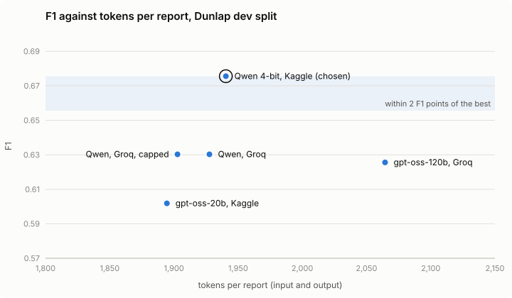

# Cost against quality: Dunlap dev split

Generated by `python -m patchsight.pipeline cost-quality`; do not edit by hand.

Every extraction configuration measured on the 60 dev reports, from its committed extraction report. The proposal's rule chooses the cheapest configuration, by tokens per report, within 2 F1 points of the best.

| Configuration | F1 | Precision | Recall | Input tokens per report | Output tokens per report | At paid rates, per 1,000 reports |
|---|---:|---:|---:|---:|---:|---:|
| Qwen3.8-27B 4-bit, Kaggle **(chosen)** | 0.676 | 0.710 | 0.644 | 1,627 | 313 | $2.55 |
| Qwen3.8-27B, Groq | 0.630 | 0.625 | 0.636 | 1,692 | 236 | $2.30 |
| Qwen3.8-27B, Groq, 14-candidate cap | 0.630 | 0.625 | 0.636 | 1,671 | 232 | $2.26 |
| gpt-oss-120b, Groq | 0.626 | 0.710 | 0.559 | 1,696 | 368 | $0.48 |
| gpt-oss-20b, Kaggle | 0.602 | 0.663 | 0.551 | 1,558 | 336 | $0.22 |
| ChangedFuncs (every changed function, no model) | 0.381 | | | 0 | 0 | $0.00 |

**Chosen: Qwen3.8-27B 4-bit, Kaggle.** It has the best F1, and no other configuration comes within 2 points of it, so the rule picks it whatever its tokens.

Tokens per report barely differ between configurations, because every role shares one prompt budget; what they cost differs more, by model.

Paid rates: the provider's published on-demand prices (https://console.groq.com/docs/models, read 2026-11-22); a self-hosted model is priced as the hosted model it stands for.
